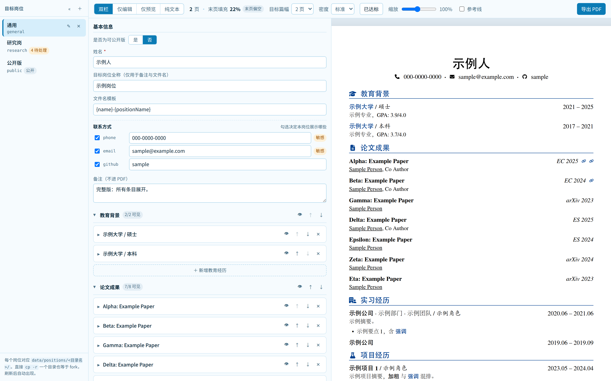
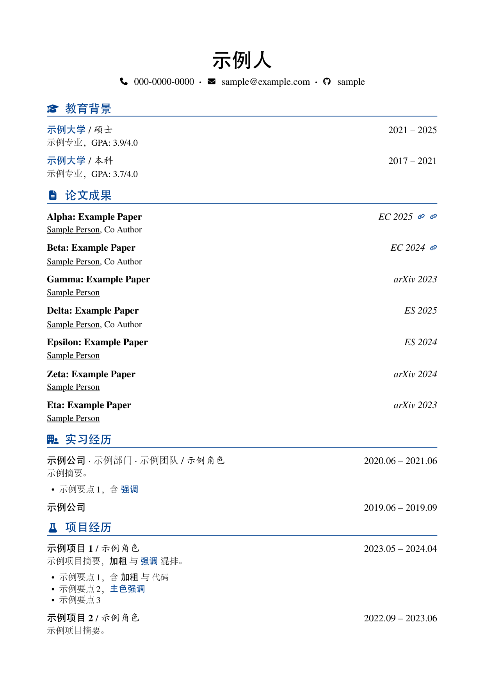
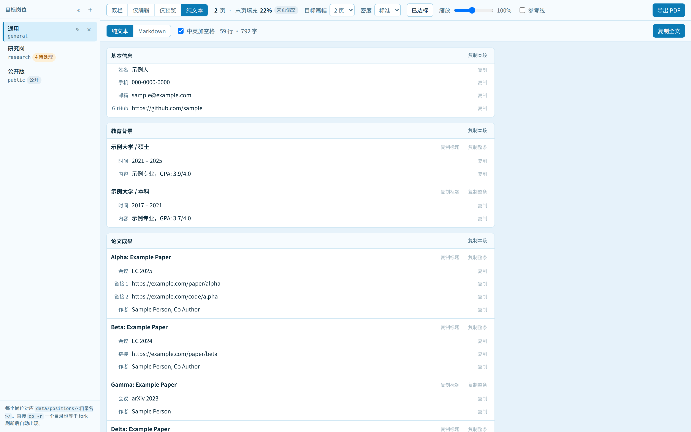

# resume-studio

**简历工作台**：表单化编辑内容 → A4 实时预览 → 导出投递级 PDF。
针对不同目标岗位维护多个版本，**内容只写一份**，岗位之间只存"取舍"。

本地运行的 Web 应用（Vue 3 + TypeScript + Vite），PDF 由**服务端 Chromium** 生成，
所以你在任何一台机器的浏览器里编辑，导出的排版都和你看到的一致。

> 你的简历只留在你自己的机器上：`data/` 目录被 `.gitignore` 忽略，仓库里只有一份
> 虚构的示例数据（`data.sample/`）。没有账号、没有云同步、没有网络请求。



<sub>左：表单编辑器；右：A4 实时预览。截图用的是仓库自带的示例数据。</sub>

---

## 它解决什么

投十家公司要十份简历，内容九成是重复的。这个工具的模型很简单：

- **一份内容池**（`data/profile.json`）：论文、项目、经历只写一次，改错别字全局生效。
- **每个岗位一个覆盖层**（`data/positions/<岗位>/position.json`）：只存"选哪些、按什么顺序、
  展开到什么程度、哪些字段换个说法"。复制一个岗位目录就是 fork 一个新版本。
- **导出时按岗位解析**：内容池 + 覆盖层 → 排版 → PDF。预览和 PDF 走同一条渲染管线。

一个岗位目录里长这样：

```
data/positions/multimodal/position.json   # 顺序、可见性、展开档、字段覆盖
data/positions/research/示例人-研究岗.pdf   # 导出产物（文件名可配）
```

---

## 快速开始

需要 Node 20+、pnpm、Python 3（只有构建字体子集时用到）。

```bash
pnpm install
pnpm run fonts                     # 用默认档案（adobe）切字体子集；字体需自备，见下
pnpm run dev                       # → http://127.0.0.1:5178
```

首次启动时若 `data/` 不存在，会自动用 `data.sample/`（示例人物「示例人」）初始化，
打开就能看到效果。**直接在这个基础上改成你自己的内容即可**（`data/` 不会被提交）。

开发服务器**只监听回环地址**，不暴露到局域网。要临时开放局域网访问：
`pnpm run dev -- --host`。端口转发（`ssh -L 5178:127.0.0.1:5178 <host>`）
不受影响 —— 转发是在远端连本机回环。

### 字体

字体必须自托管：你可能通过端口转发在另一台机器的浏览器里编辑，那台机器不保证有这些字体。

**仓库不分发任何字体文件**——商业的、OFL 的都不分发。仓库里只有「字体档案」，
描述"哪个角色用哪个字体文件"，源字体由你自己提供，产物只落在本机（已 gitignore）。

内置两个档案：

| 档案 | 拉丁 | 中文 | 许可 |
|---|---|---|---|
| `adobe`（**默认**） | TeX Gyre Termes | Adobe 宋体 / 黑体 / 楷体 | 商业字体，**必须自备**，仓库不分发 |
| `oss` | TeX Gyre Termes | Noto Serif SC（正体）/ Noto Sans SC（粗体） | 均为 OFL-1.1 |

默认档案 `adobe` 的排版与参考模板（[luooofan/resume](https://github.com/luooofan/resume)
的 `resume.cls`）一致：拉丁 Termes，中文宋体（正体）、黑体（粗体）、楷体（斜体）。
那三个 Adobe 字体是商业字体，得自己准备好：

```bash
RESUME_FONT_SRC=/path/to/fonts pnpm run fonts     # 目录里要有那三个 .otf + Termes
pnpm run fonts --list-profiles                    # 看有哪些档案
pnpm run fonts --profile oss                      # 换成 Noto 组合
```

没有 Adobe 字体、只想跑起来看效果，用 `oss` 档案（OFL，可下载）：

```bash
bash scripts/prepare-fonts.sh        # 下载 TeX Gyre Termes + Noto Serif/Sans SC 并切子集
```

它会把字体下到 `fonts/`（已 gitignore）。中断了直接重跑即可（断点续传）。
系统里已经装了 `fonts-noto-cjk` / `tex-gyre` 的话，这一步会自动跳过下载。

`oss` 档案里中文没有真正的斜体字重（Noto CJK 只有 Regular/Bold），脚本会**合成**斜体
（斜切轮廓，字宽不变）——这样预览和 PDF 用的是同一份字形，不会出现"浏览器合成了、
PDF 没合成"的分歧。观感与默认档案有细微差别（宋体 → Noto Serif）。

> **没跑字体脚本就导出会退化**：浏览器会退回系统字体，Chromium 只能把系统 CFF 字体
> 以 Type3 嵌进 PDF（逐字形填充路径，没有字体名，体积大三倍，放大发虚）。
> 导出时会有提示。预览与 PDF 仍然一致，只是不如自托管字体好看。

界面字体是 **Inter**（另一套，`Resume UI`）。界面绝不能用简历的衬线字族，否则整屏英文
会变成 Times 风格。缺 Inter 时会退回系统 sans，功能不受影响。

---

## 数据在哪

```
data/                                  # 你的真实数据（git 忽略，不会上传）
├── profile.json                      # 内容池：唯一的内容来源，所有岗位共用
├── positions/<岗位目录名>/
│   ├── position.json                 # 这个岗位的取舍：顺序、可见性、展开档、字段覆盖
│   ├── local-items.json              # 只属于本岗位的条目（可选）
│   └── 示例人-研究岗.pdf                # 导出产物
├── templates/*.json                  # 排版参数（字号/间距/配色/断页规则）
└── .trash/                           # 软删除与自动备份

data.sample/                           # 仓库里唯一的样例数据（虚构人物）
```

**新建岗位 = 新建一个目录。** 应用扫 `data/positions/*/position.json` 得到列表，
没有索引文件，所以直接 `cp -r data/positions/general data/positions/infra` 再刷新
也等于一次 fork。

### 实习条目的组织链

`公司 · 部门 · 团队 / 角色` —— 两套分隔符对应两种关系：

- **` · `** 组织包含链（公司 ⊃ 部门 ⊃ 团队），按嵌套顺序排列
- **` / `** 并列维度（组织 vs 角色），与 `resume.cls` 里「某大学 / 硕士」一致

若层级也用 `/`，`某公司 / 智能创作 / 视频架构 / 算法工程师` 会拉平成四个并列项，
读不出包含关系。缺项自动跳过，不会留下多余分隔符。

`·` 两侧留空格是必要的：团队名本身可能含紧排的间隔号（如「某某·某项目」），
带空格的分隔符才能与词内的点区分开。多个并列团队建议用「、」连接。

### 新增与删除条目

编辑器里每个小节底部有「＋ 新增论文 / 新增实习经历 …」按钮，加进**内容池**并在
当前岗位直接可见；其他岗位会进 `pendingItems` 队列等你表态。新建的条目是空的，
必填字段显示红色「必填」提示 —— schema 不拦空值（否则新建即写出打不开的数据），
内容完整性由编辑器的红角标负责。

条目卡片上的 `✕` 是**从内容池永久删除**，会清掉所有岗位里对它的引用，删除前会
列出哪些岗位正在用。只想在当前岗位不显示，用 👁 按钮 —— 内容保留。
误删可从 `data/.trash/autosave/` 找回上一版 `profile.json`。

空白新建的岗位没有任何小节，编辑器底部会列出「未启用的小节」供你一键启用。

### 内容一份，取舍各自

改错别字改 `profile.json` 一处，所有岗位同时生效。岗位之间的差异只存在覆盖层里：

- **顺序**：`position.json` 里 `sections` / `items` 的数组顺序就是渲染顺序
- **可见性**：`visible: false` 保留条目但不渲染
- **展开档**：项目/实习 `titleOnly | summary | full`；论文 `tight | standard | expanded`
- **一句话展开**（`pitch`）：论文专属，**内容池里不存这个字段**，各岗位互不影响
- **字段覆盖**（`overrides`）：偶发的措辞调整，编辑器会显示「已覆盖」与「恢复继承」

内容池新增条目时，其他岗位不会静默显示（怕公开版泄漏）也不会静默隐藏（怕忘记投），
而是进 `pendingItems` 队列，在编辑器顶部要求你表态。

### 行内标记

文本字段支持一小套标记，编辑器每个输入框上方有按钮，不用手打：

| 写法 | 效果 |
|---|---|
| `**文本**` | 加粗 |
| `==文本==` | 主色加粗（强调关键结果） |
| `` `文本` `` | 等宽（`MMPreTrain` 这类标识符） |
| `_文本_` | 下划线 |
| `*文本*` | 斜体 |
| `[文本](url)` | 链接（PDF 里可点） |
| `\*` | 转义 |

分隔符后紧跟空格时不视为标记（`a * b` 不会被吞），`_` 要求词边界（`torch_dtype` 安全）。

---

## 导出

点「导出 PDF」会做两件事：在服务端生成 PDF 写入 `data/positions/<id>/`，同时推给
浏览器下载。**服务端生成是有意的** —— 你可能把端口转发到另一台机器上用浏览器编辑，
那台机器不保证有中文字体，交给服务端才能保证 PDF 与预览一致。

文件名由 `position.json` 的 `meta.filenameTemplate` 决定，默认
`{name}-{positionName}-{phone}`。取不到值的占位符整段省略（公开版不勾手机号时
不会产出 `张三-通用-.pdf`）；`{phone}` 会自动去掉连字符。

导出会用本机已装的 Chrome/Edge；没有就回落 Playwright 自带的 Chromium
（`npx playwright install chromium`）。

## 目标篇幅与「压到 N 页」

工具栏的**目标篇幅**下拉决定两件事：何时显示「超出目标」告警、以及「压到 N 页」
按钮压到几页。每个岗位独立设置（存在 `position.json` 的 `layout.targetPages`）——
投研究岗可以放宽到 2 页，投互联网岗设成 1 页。

当前页数已在目标之内时，按钮显示「已达标」；末页填充率低于 25% 时会提示「末页偏空」
（目标 2 页但第 2 页只有几行，通常比压成 1 页更难看）。

点「压到 N 页」后从 100% 往下逐档试等比缩放（步长 2%，**下限 90%**），取第一个装得下的。
下限是可读性红线：正文 10.95pt 缩到 90% 约 9.9pt，再小打印稿上就吃力了。

**压不下去时不会硬压**，而是还原并量化告诉你差多少：

> 缩到 90% 仍需 2 页（末页占 24%），已还原。继续缩会伤可读性 —— 建议隐藏约 24% 一页的
> 内容（要点、论文档位降到「紧凑」），或把目标改成 2 页。

「末页占 24%」就是你需要删掉的量。光说"装不下"没用，得知道是差两行还是差半页。

比缩放更有效的办法：

- 论文用 `tight` 档（会议简称移到标题行右端，作者独占一行），比 `standard` 每篇省一行
- 同一份工作别写两遍：在项目摘要里手写一句「成果发表于某某会议 2026」，
  然后把论文区那条设为不可见
- 要点尽量一条一行，写到第二行通常是铺垫，可以并进摘要或删掉

---

## 排版为什么这么实现

- **分页是 JS 预计算的**，产出显式的 `.page` 盒子，打印时 Chromium 没有自主断页空间。
  这是「PDF 断页位置 = 预览断页位置」的根本原因，也是 `break-inside: avoid` 之类
  CSS 做不到的（它还无法在屏幕上显示断页位置）。
- **预览与导出共用**同一份组件、CSS、字体文件和分页器。允许不同的只有质量档
  （字体加载方式、抗锯齿参数、屏幕装饰）。`check:fidelity` 会验证这件事。
- **字体必须转成 glyf（TrueType）轮廓。** Chromium/Skia 无法把 CFF / CID-keyed 字体
  嵌进 PDF，会退化成 Type3（逐字形填充路径：没有字体名、无法 hinting、体积翻倍）。
  `scripts/build-fonts.py` 用 cu2qu 把三次贝塞尔转成二次写进 glyf，Chromium 就会
  正常做 Type0 子集嵌入 —— 与 xelatex 的产物一致，文件也小一半。
  转换只改轮廓表示，不动字宽，所以排版度量不变（由 `check:fidelity` 兜底）。
- **CJK 标点必须由中文字体提供。** 若把 `U+FF00-FFEF` 声明在拉丁那一档，
  浏览器不会继续往下找中文字体，而是直接落到系统字体 —— 全角逗号、括号会变形。
- **字体按 unicode-range 分层**：拉丁 15KB 首屏可用，GB2312 常用汉字一层，
  生僻字与扩展 A 另一层按需加载。整块覆盖换取「永远不缺字」。
- **图标是内联 SVG** 而非图标字体：矢量、跟随 `currentColor`、PDF 里不会出现字距异常。

### 模板

只保留一套模板 `academic-serif`：

| 模板 | 版式 |
|---|---|
| `academic-serif` | **参考 [luooofan/resume](https://github.com/luooofan/resume) 的 `resume.cls`**（MIT）：页首姓名居中 + 联系方式居中带 `·` 分隔、小节标题带图标与横线、论文三行式、作者名仅下划线不加粗、教育条目两行式 |

`academic-serif` 是照着 [luooofan/resume](https://github.com/luooofan/resume) 的
`resume.cls` 复刻的：页首姓名居中 + 联系方式居中带 `·` 分隔、小节标题带图标与横线、
论文三行式、作者名仅下划线不加粗、教育条目两行式。致谢原作者
([fanfan](https://github.com/luooofan))，本项目沿用其 MIT 许可下的版式思路。

模板就是一份 JSON（`data/templates/*.json`：字号、间距、配色、断页规则），
想加第二套模板，写一个 JSON 就行，不用改代码。



<sub>用仓库自带的示例数据导出的第一页（`academic-serif` 模板）。</sub>

### 纯文本视图（`Ctrl+4`）

公司自建 ATS 的投递表单大多不收 PDF，要手敲或粘贴。这个视图把简历
转成可复制的纯文本 / Markdown，可按**字段 / 条目 / 小节**三级复制，链接从会议名里
拆成独立一栏。

它建在 `Block[]` 之上而不是直接遍历 `profile` —— 这样岗位层的取舍与脱敏自动生效，
不会出现「预览里有、复制出来没有」的分叉。



---

## 快捷键

| 键 | 作用 |
|---|---|
| `Ctrl+S` | 立即保存（平时 400ms 自动保存） |
| `Ctrl+B` | 收起 / 展开左侧岗位栏（收起后仍是一条可点的窄轨道） |
| `Ctrl+1/2/3` | 双栏 / 仅编辑 / 仅预览 |
| `Ctrl+4` | 纯文本 / Markdown 视图 |
| `Ctrl+Z` / `Ctrl+Shift+Z` | 撤销 / 重做 |

## 常用命令

| 命令 | 作用 |
|---|---|
| `pnpm run dev` | 启动工作台（内含 data API 与 PDF 导出端点） |
| `pnpm run export` | 批量导出全部岗位；`pnpm run export mllm` 只导一个 |
| `pnpm run check:fidelity` | **改过 `src/render/` 或 `src/styles/` 后必须跑**：校验预览与 PDF 的分页完全一致 |
| `pnpm test` | 单元测试（分页规则、行内标记、覆盖层语义） |
| `pnpm run fonts` | 重新生成字体子集（`--profile adobe` 换档案） |
| `bash scripts/prepare-fonts.sh` | 下载开源字体（TeX Gyre Termes + Noto SC）并生成子集，无需 root |
| `pnpm run icons` | 从 iconify 重新抽取图标（改了 `scripts/build-icons.ts` 的 WANTED 后跑） |
| `pnpm run typecheck` | `vue-tsc --noEmit` |

`export` 与 `check:fidelity` 都需要 `dev` 在另一个终端跑着。

---

## 目录结构

```
src/schema/     zod schema + 类型 + migrations/
src/render/     resolve → blocks → inline/autospace → paginate
src/components/ sidebar/ editor/ preview/
src/styles/     tokens.css resume.css page.css print.css
src/pages/      PrintView.vue（导出用的无装饰路由 /print?position=<id>）
server/         Vite 插件：data REST API + 服务端 PDF 导出
scripts/        字体下载与子集、保真校验、批量导出
data.sample/    示例简历（虚构人物）——既是仓库示例，也是测试固件
assets/         README 用的图片（截图等）
docs/DESIGN.md  设计文档
AGENTS.md       给后续维护者（含 AI）的硬约束
```

## 参与开发

先读 `AGENTS.md`（硬约束：不要动 `data/`、不要破坏渲染契约、不要引新依赖）
和 `docs/DESIGN.md`（设计与取舍记录）。

```bash
pnpm install
bash scripts/prepare-fonts.sh
pnpm run dev
pnpm test && pnpm run typecheck
```

改动 `src/render/` 或 `src/styles/` 后，**必须**在另一个终端跑 `pnpm run dev`，
然后 `pnpm run check:fidelity` —— 它比对预览与导出两个环境的分页结果与 y 偏移。
失败意味着预览与 PDF 已经不一致，**不要调容差绕过**。

贡献指南见 [CONTRIBUTING.md](CONTRIBUTING.md)。

## License

[MIT](LICENSE)。字体子集由使用者本机生成，仓库不分发任何字体文件；
各字体的许可见所用档案（`oss` 档案里的字体均为 OFL-1.1）。

致谢：

- [luooofan/resume](https://github.com/luooofan/resume) —— `academic-serif` 模板的版式参考（MIT）
- [TeX Gyre](https://ctan.org/pkg/tex-gyre) —— 拉丁字体（OFL-1.1）
- [Noto CJK](https://github.com/notofonts/noto-cjk) —— 中文字体（OFL-1.1）
